<div align="center">

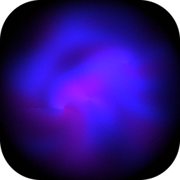

<h1>RateIt</h1>

<p><b>Rate your music. Own your taste.</b></p>

<p>A local-only macOS app for rating every album you listen to.<br>
No cloud. No subscription. Your library lives on your Mac.</p>

<a href="https://github.com/sjcsoftware/rateit/releases/latest"></a>
<a href="#install"></a>
<a href="#tech-stack"></a>
<a href="LICENSE"></a>

<br><br>

<a href="https://github.com/sjcsoftware/rateit/releases/latest"><b>Download</b></a>
&nbsp;·&nbsp;
<a href="#setup">Setup</a>
&nbsp;·&nbsp;
<a href="#features">Features</a>
&nbsp;·&nbsp;
<a href="#screenshots">Screenshots</a>
&nbsp;·&nbsp;
<a href="CONTRIBUTING.md">Contributing</a>

<br><br>

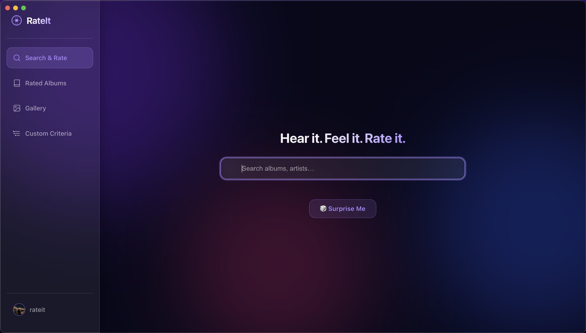

</div>

## Features

| | |
|---|---|
| **Search & Rate** | Find any album on Spotify. Rate each track (1–5 ★) and five criteria. Overall score out of 10 is calculated for you. |
| **Rated Albums** | Your library, sortable by score or date, groupable by artist or genre. |
| **Gallery** | Album cards themed with each cover's dominant colour. Click to expand, click again to flip for the score breakdown. |
| **Custom Criteria** | Rename, add, or reweight the scoring criteria (default: Flow, Production, Lyricism, Originality, Replay). Weights total 100%. |
| **Profile** | Taste stats and a Hall of Fame of your top 3 albums. |
| **Year in Review** | Albums per month, average score, top genre, most active month, best and worst album of the year. |
| **Surprise Me** | Random album pick, weighted toward your top genres. |
| **Export** | JSON, CSV, or a styled self-contained HTML page. |
| **Open in Spotify** | Jump straight to any album in the Spotify app. |

## Screenshots

<table>
  <tr>
    <td width="50%">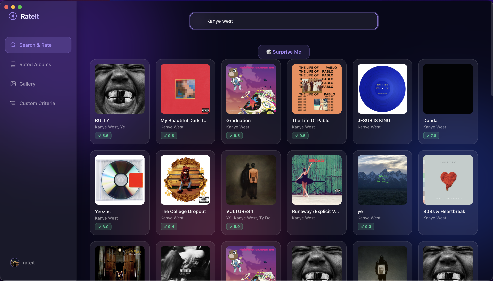<p align="center"><b>Search</b></p></td>
    <td width="50%">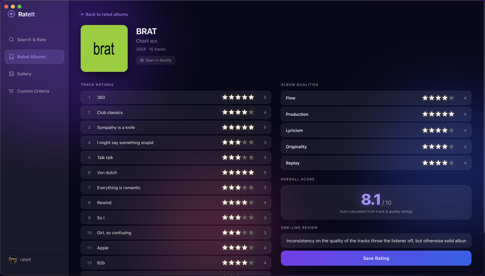<p align="center"><b>Rating</b></p></td>
  </tr>
  <tr>
    <td width="50%">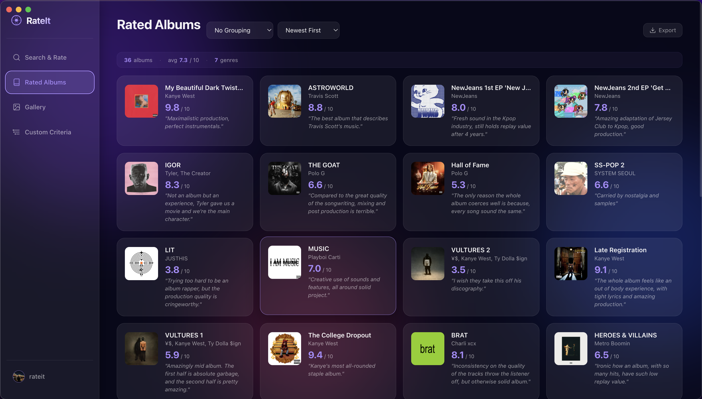<p align="center"><b>Rated Albums</b></p></td>
    <td width="50%"><p align="center"><b>Gallery</b></p></td>
  </tr>
  <tr>
    <td width="50%">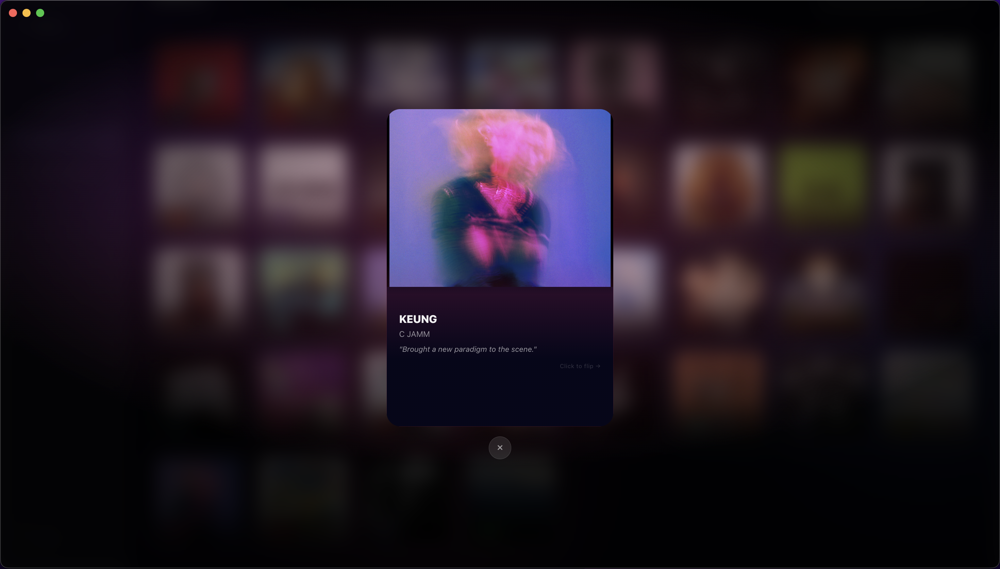<p align="center"><b>Gallery card</b></p></td>
    <td width="50%">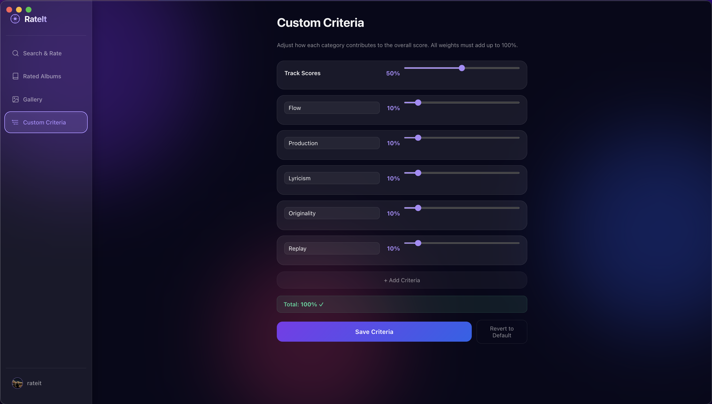<p align="center"><b>Custom Criteria</b></p></td>
  </tr>
  <tr>
    <td width="50%">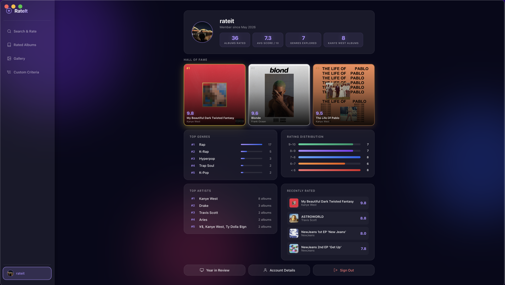<p align="center"><b>Profile</b></p></td>
    <td width="50%">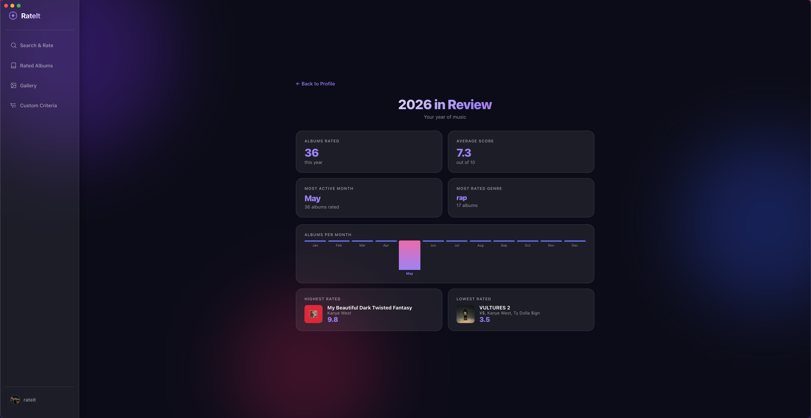<p align="center"><b>Year in Review</b></p></td>
  </tr>
</table>

## Install

| Mac | Download |
|---|---|
| Apple Silicon (M1 and later) | `RateIt-<version>-arm64.dmg` |
| Intel | `RateIt-<version>-x86-64.dmg` |

Get the DMG from [**Releases**](https://github.com/sjcsoftware/rateit/releases/latest), open it, and drag **RateIt** to Applications.

> [!NOTE]
> **Updating:** RateIt has no auto-update. Delete the old app and install the new DMG. Your account and ratings are kept, and you stay logged in.

<details>
<summary><b>Build from source</b></summary>

<br>

Requires Node.js 18+.

```sh
git clone https://github.com/sjcsoftware/rateit.git && cd rateit
npm install
npm run rebuild   # compile SQLite for Electron
npm start         # run in dev mode
npm run build     # DMGs in dist/
```

</details>

## Setup

RateIt needs your own Spotify API keys to search albums. A free Spotify account is enough.

| Step | |
|---|---|
| **1** | Open the [Spotify Developer Dashboard](https://developer.spotify.com/dashboard) and sign in. |
| **2** | **Create App**. Any name and description. Redirect URI: `https://localhost`. Check **Web API**. |
| **3** | In the app's settings, copy the **Client ID** and **Client Secret**. |
| **4** | Launch RateIt, create a local account, and paste both values. |

<p align="center">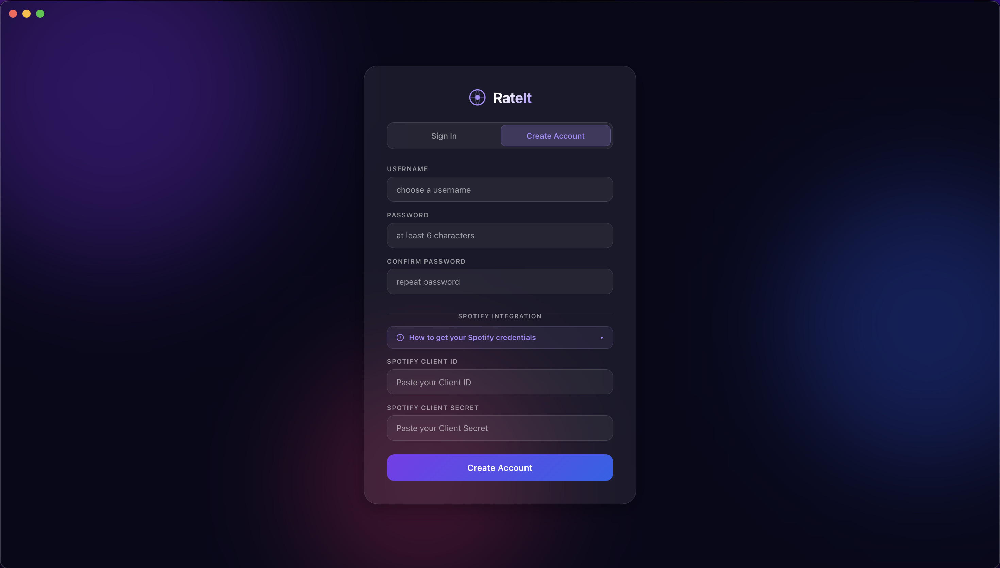</p>

> [!IMPORTANT]
> **Everything stays on your Mac.** The sign-up account and your keys are stored in a local database and never sent anywhere. Spotify is only used to search albums and fetch track lists. Your ratings never leave your machine.

## Your data

| | |
|---|---|
| **Location** | `~/Library/Application Support/rateit/ratings.db` |
| **Survives updates** | Yes |
| **Backup** | Copy the file above, or use **Export** in Rated Albums |
| **Export formats** | JSON, CSV, or a styled HTML page (below) |

<p align="center">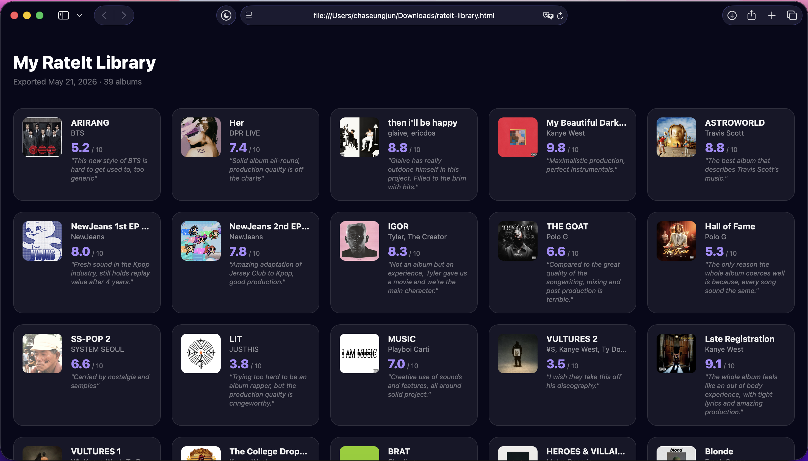</p>

Re-rating with new criteria: albums keep the criteria they were rated with. Open one from **Rated Albums** and hit **↻ Refresh Criteria** to re-rate it with your current set.

## Tech stack

| | |
|---|---|
| Shell | Electron 28 |
| Server | Express 5, better-sqlite3 |
| Frontend | Vanilla JS / CSS, no frameworks |
| Database | SQLite, local only |
| Music data | Spotify Web API (search and metadata) |

## Contributing

PRs are welcome. See [CONTRIBUTING.md](CONTRIBUTING.md) for setup, project layout, and the release process.

## License

[MIT](LICENSE) © 2026 Cha Seungjoon
